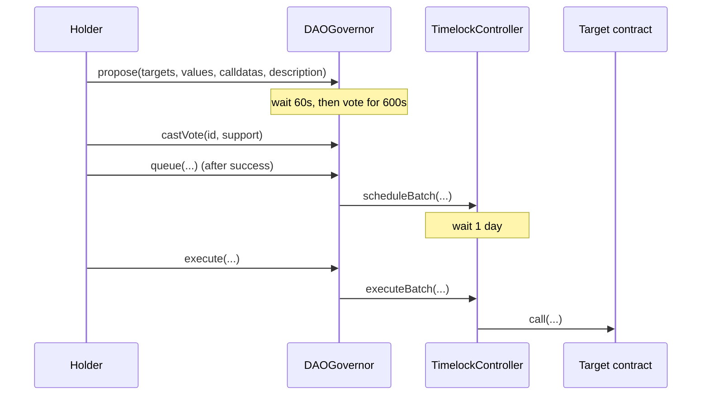

# DAO Governance: Design Doc

## Metadata

- Status: Draft
- Target chain: Arc Testnet (USDC is the native gas token)
- Toolchain: Solidity 0.8.28, Foundry, EVM target `cancun`, OpenZeppelin Contracts 5.6.1
- Contracts: `DAOToken` (governance token), `DAOGovernor` (governor, deploys its own timelock)
- Reviews: [ ] Design  [ ] Security

## Action Items (living)

_Empty. Filled after each review round._

## Goals / Non-Goals

Goals
- Token-weighted on-chain governance: holders delegate votes, create proposals, vote, queue and execute.
- Fixed 1,000,000 token supply minted once to a holder chosen at deploy.
- A 1 day timelock between a proposal passing and executing.
- No admin keys, no pause, no upgrade path. Every change goes through a passed proposal.

Non-Goals
- No treasury logic, vesting, or payout code (voting only). Anything sent to the timelock is controlled by the DAO.
- No upgradeability, no emergency pause, no off-chain/gasless voting relayer.
- No frontend (can be added later on request).

## Requirements

Functional
- F1. Anyone can create a proposal (threshold 0).
- F2. Voting starts 60 seconds after creation and lasts 600 seconds.
- F3. A proposal succeeds if quorum (4% of total supply at the snapshot) is met and For votes exceed Against votes. Abstain counts toward quorum.
- F4. A succeeded proposal is queued in the timelock, and anyone can execute it after 1 day.
- F5. Voting power comes from delegated token balance, snapshotted at proposal start.

Security (testable assertions)
- S1. No function can mint after construction: total supply is constant.
- S2. Only the timelock can call the governor's settings setters and `relay`.
- S3. Only the governor holds proposer/canceller rights on the timelock; no external account holds the timelock admin role (the timelock administers itself, so role changes need a passed proposal and the 1 day delay).
- S6. The constructor rejects a voting token that is zero, not a contract, or not on a timestamp clock.
- Accepted tradeoff: queued proposals do not expire (standard OpenZeppelin behavior).
- S4. A proposal cannot execute before the timelock delay has elapsed.
- S5. A voter cannot vote twice on one proposal, and token transfers after the snapshot do not change that proposal's vote weight.

## Terminology and Actors

| Actor | Trust | Can do |
| --- | --- | --- |
| Token holder / delegate | Untrusted | Delegate, vote, propose, queue, execute |
| Initial holder (deploy-time address) | Semi-trusted | Receives 1,000,000 tokens, holds the initial voting majority until it distributes tokens |
| Governor contract | Trusted (immutable code) | Only proposer/canceller on the timelock |
| Timelock | Trusted (immutable code) | Executes passed proposals, owns governor settings |
| Deployer | Untrusted after deploy | Has no privileges after the constructor finishes |

Terms: snapshot = voting-power checkpoint at proposal start; delegation = assigning voting power (including to yourself); quorum = minimum participating votes.

## Language / Runtime

- Solidity 0.8.28 (project pin), checked arithmetic, `cancun` EVM.
- Based on OpenZeppelin `ERC20`, `ERC20Permit`, `ERC20Votes`, `Governor`, `GovernorSettings`, `GovernorCountingSimple`, `GovernorVotes`, `GovernorVotesQuorumFraction`, `GovernorTimelockControl`, `TimelockController`. Preserved as is, except the clock override below.
- Clock mode: timestamp. Both contracts override `clock()` to `block.timestamp` and `CLOCK_MODE()` to `mode=timestamp`, so the 60 s delay and 600 s period are real seconds. Arc blocks are fast, so block-number delays would be unpredictable.

## Transaction and Execution Model

Each call is atomic. Re-entry surface: proposal actions run only from the timelock during `execute`, using OpenZeppelin's state checks (operation marked done before the call). No custom external-call code is added.

## Chain Standards and Interfaces

- ERC-20, ERC-2612 (permit), ERC-5805 / ERC-6372 (votes with timestamp clock), IGovernor (OZ 5.x, Bravo-style counting: 0 Against, 1 For, 2 Abstain).
- EVM-to-Arc role mapping: N/A. Arc is EVM-equivalent; native gas is USDC, which the contracts never touch directly.

## Architecture Overview

Flow of funds
| Step | Who moves what | Invariant |
| --- | --- | --- |
| Deploy | Token mints 1,000,000 to initial holder | Supply is constant afterwards |
| Execute | Timelock sends only what a passed proposal specifies | Only funds already held by the timelock can move |

Resting-state invariant: governor holds no funds. Timelock holds only what someone voluntarily sends it.

Dependencies: none external. No oracles, no other contracts.

## Contract Design

### DAOToken
- Inherits `ERC20, ERC20Permit, ERC20Votes`.
- Constructor `(string name, string symbol, address initialHolder, uint256 initialSupply)`: reverts on zero holder or zero supply; mints once.
- No owner, no mint, no burn. Overrides `_update`, `nonces`, `clock`, `CLOCK_MODE` as required.

### DAOGovernor
- Inherits `Governor, GovernorSettings, GovernorCountingSimple, GovernorVotes, GovernorVotesQuorumFraction, GovernorTimelockControl`.
- Constructor `(string name, IVotes token, uint48 votingDelay, uint32 votingPeriod, uint256 proposalThreshold, uint256 quorumPercent, uint256 timelockDelay)`.
- The constructor creates its own `TimelockController(timelockDelay, [address(this)], [address(0)], address(0))`: governor is sole proposer/canceller, anyone can execute, no admin. This removes the usual circular-deployment problem and leaves no key that could grant roles.

Roles
| Role | Holder | Permissions | Why |
| --- | --- | --- | --- |
| Proposer / Canceller (timelock) | Governor | Schedule and cancel operations | Only passed votes can schedule |
| Executor (timelock) | Anyone (`address(0)`) | Execute ready operations | Liveness: no one can block execution |
| Timelock admin | Nobody | None | No backdoor |

Storage: inherited OpenZeppelin storage only; no custom variables beyond the timelock address held by `GovernorTimelockControl`. Not upgradeable, so no layout rule applies.

Write functions (governor, from OZ)
| Function | Caller | State | Event | Reverts |
| --- | --- | --- | --- | --- |
| `propose` | Anyone with votes >= threshold (0) | New proposal | `ProposalCreated` | Empty or mismatched arrays, duplicate proposal |
| `castVote*` | Any account | Records vote | `VoteCast` | Not active, already voted |
| `queue` | Anyone | Schedules in timelock | `ProposalQueued` | Not succeeded |
| `execute` | Anyone | Runs actions via timelock | `ProposalExecuted` | Not queued, delay not elapsed, action reverts |
| `cancel` | Proposer, before voting starts | Cancels | `ProposalCanceled` | Not pending or not proposer |
| `setVotingDelay/Period/ProposalThreshold`, `updateQuorumNumerator` | Timelock only (via proposal) | Changes settings | Matching events | Not governance, invalid value |

Events: all standard OpenZeppelin events (monitoring contract). No custom events.

## Specification Tables

Voting parameters (fixed at deploy, changeable only by proposal)
| Parameter | Value | Note |
| --- | --- | --- |
| Voting delay | 60 s | Demo setting |
| Voting period | 600 s | Demo setting |
| Proposal threshold | 0 | Anyone can propose |
| Quorum | 4% of past total supply | Fraction denominator 100 |
| Timelock delay | 86,400 s (1 day) | Fixed in the timelock; change only through the timelock |

## Deployment and Initialization

1. Deploy `DAOToken("<name>", "<symbol>", initialHolder, 1_000_000e18)`.
2. Deploy `DAOGovernor("<name>", token, 60, 600, 0, 4, 86400)`. The timelock is created and wired in the same transaction.
3. The initial holder calls `delegate(self)` on the token to activate its votes.

No post-deploy role calls are needed. The initial holder must be a real address you control. It must not be the shared platform deployer wallet.

## Upgradeability

None. Migration story: contract switch. A new DAO is a new deployment; the DAO can vote to move assets held by its timelock to the new one.

## Key Management and Signing

No privileged keys after deploy. `ERC20Permit` and `castVoteBySig` use EIP-712 with nonces, deadlines and domain separation (OpenZeppelin).

## Security Considerations

| Vulnerability | Applicable? | Mitigation |
| --- | --- | --- |
| Reentrancy | Low | Only timelock executes arbitrary calls; OZ marks operation done first |
| Access control | Yes | Governance-only setters; no admin; sole proposer is the governor |
| Overflow/underflow | Checked 0.8.28 | No `unchecked` added |
| Unchecked external call | Yes | Failed action reverts the whole execution |
| Fee-on-transfer / rebasing | No | No external tokens handled |
| Signature replay | Yes | OZ nonces, deadline, domain separator, chainId |
| Front-running / MEV | Partial | Proposal ids are deterministic; threshold 0 allows griefing proposals (cheap to ignore) |
| Flash-loan voting | Mitigated | Snapshot at proposal start, one delay before voting opens |
| Oracle manipulation | No | No oracle |
| Denial of service | Partial | No loops over user input in custom code; proposal spam possible with threshold 0 |
| Delegatecall / proxy | No | No proxy |
| Timestamp dependence | Yes | Timestamp clock; seconds-scale tolerance, not used for randomness |
| Approval persistence | No | No approvals taken |
| Centralization | Yes | Initial holder has 100% of supply at launch; documented below |
| Stuck governance | Yes | If less than 4% of supply is delegated, nothing can pass. Holder must delegate. |

## Trust Model and Threat Analysis

| Actor | Max damage if compromised | Mitigation | Detection |
| --- | --- | --- | --- |
| Initial holder key | Controls every vote and can pass any proposal | Distribute tokens and delegate; 1 day timelock gives time to react | `DelegateVotesChanged`, `ProposalCreated` |
| Majority coalition | Same as above for the whole DAO | Timelock window, quorum | Same events |
| Governor, Timelock | None beyond code bugs | Audited OZ code, no admin | N/A |

## Emergency Response

By design, no pause or rescue role. Mitigation is the 1 day timelock plus the proposer's ability to cancel before voting starts. A malicious proposal that passes cannot be stopped inside the timelock window because no guardian exists (rejected: guardian role, see Tradeoffs).

## Failure Scenarios

- Action reverts at execution: the whole operation reverts, remains queued, can be retried.
- Quorum never reached: proposal is Defeated, no state change.
- Nobody delegates: no votes exist, no proposal can pass. Recoverable only by holders delegating (tokens are not lost).

## Priorities and Tradeoffs

| Decision | Tradeoff | Rationale / rejected alternative |
| --- | --- | --- |
| Timestamp clock | Deviates from OZ block-number default | Real-time seconds on a fast-block chain |
| Governor deploys its own timelock | Timelock address is bound to one governor | Rejected: timelock with temporary admin (leaves a key that must be renounced) |
| No guardian / pause | Cannot stop a bad passed proposal | Matches "immutable, no admin keys" choice. Rejected: guardian multisig |
| Threshold 0 | Spam proposals possible | Matches demo choice |
| Demo 60 s / 600 s | Too short for real governance | Changeable by a passed proposal |
| Fixed supply | No future issuance | Simplicity, no inflation attack |

## Testing Strategy

- Foundry unit tests: deploy wiring, roles (no admin, governor is proposer), full lifecycle (propose, vote, queue, wait, execute), quorum and defeat paths, double vote, delegation snapshot, timelock delay enforcement, setter access control, token supply constant.
- Fuzz: vote weights vs supply, transfer after snapshot.
- Static analysis: Slither. Fork rehearsal on Arc Testnet before the live deploy.
- Command: `forge test -vv`.

## Third-party libraries

| Lib | Version | Existing dep | Why | Reviewed |
| --- | --- | --- | --- | --- |
| @openzeppelin/contracts | 5.6.1 | Yes | Standard, audited governor and votes | Yes (OpenZeppelin) |

## Monitoring and Alerting

| Event | Severity | Why |
| --- | --- | --- |
| `ProposalCreated` | Info | New proposal |
| `ProposalQueued` | Warning | Starts 1 day countdown |
| `ProposalExecuted` | Info | State changed |
| `DelegateVotesChanged` (large) | Warning | Voting power shift |

## Stakeholders

Contract owner (you) for design, an independent security reviewer for the code before any mainnet use.

## Worked Example

Initial holder delegates to self, calls `propose([token],[0],[calldata for a harmless call],"Test")`. After 60 s it votes For (100% of supply, quorum met). After the 600 s voting ends it calls `queue`, waits one day, then `execute`. Events: `ProposalCreated`, `VoteCast`, `ProposalQueued`, `ProposalExecuted`.
